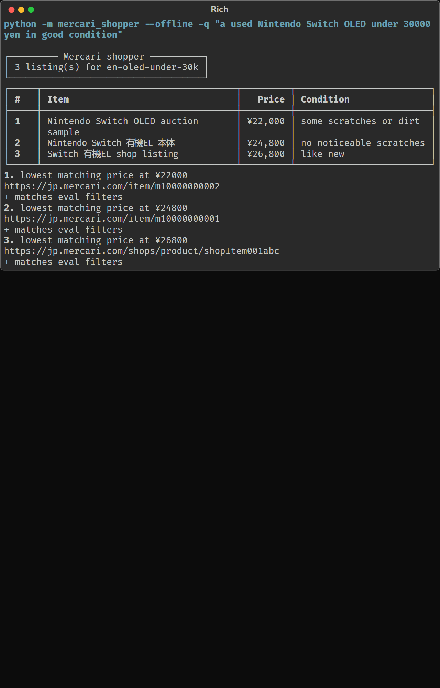
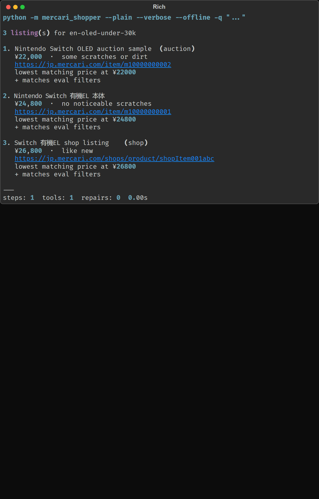
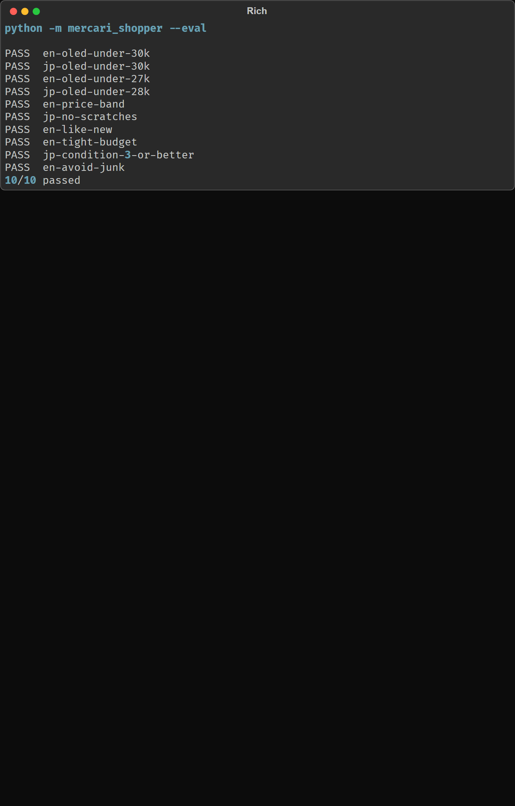
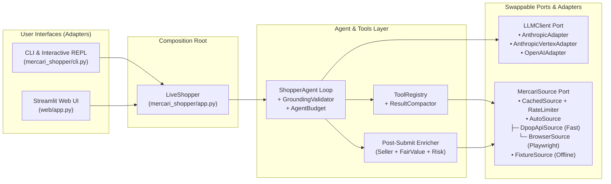

# Mercari Japan AI Shopper

A natural-language shopping assistant for **Mercari Japan** (`jp.mercari.com`), built from scratch in Python using LLM function/tool calling without any heavy agent frameworks.

Give the agent a plain request in **English or Japanese**—for example, *"a used Nintendo Switch OLED under 30000 yen in good condition"* or *「中古のNintendo Switch 有機EL 3万円以下」*—and it will:

1. Understand your intent, budget, and condition constraints.
2. Expand your request into Japanese keywords, model numbers, and synonyms.
3. Search Mercari Japan in parallel, check real sold-out prices to see what a fair market price looks like, and inspect shortlisted items for seller ratings and warning signs.
4. Return **3 ranked recommendations** grounded in real listings, complete with prices, condition labels, fair-value scores, explicit pros and cons, seller ratings, and direct Mercari URLs.

### Demo glimpse

Recorded walkthroughs and CLI snapshots are in [`docs/demo/`](docs/demo/) (videos are stored with **Git LFS**).

| Recording | What it shows |
|---|---|
| [web-ui-demo.mp4](docs/demo/web-ui-demo.mp4) | Streamlit Web UI: live progress, ranked picks, and Mercari links |
| [readme-walkthrough.mp4](docs/demo/readme-walkthrough.mp4) | End-to-end tour of this README and how to run the project |

<video controls src="docs/demo/web-ui-demo.mp4" width="720"></video>

**CLI (offline fixtures — no API key):**








Regenerate PNGs after UI changes: `python scripts/generate_demo_cli_screenshots.py` (requires Playwright Chromium).

---

## Table of Contents

1. [Overview](#1-overview)
2. [Setup Instructions](#2-setup-instructions)
3. [Usage Instructions](#3-usage-instructions)
4. [Design Choices](#4-design-choices)
5. [Potential Improvements](#5-potential-improvements)
6. [Terms of Service & Ethical Use Note](#6-terms-of-service--ethical-use-note)

---

## 1. Overview

### What Problem This Solves

Shopping on a secondhand marketplace like Mercari Japan is harder than shopping on a normal store:

- **Keyword barrier:** Most listings are written in Japanese with specific model numbers. Searching in English misses almost everything.
- **"Is this price fair?":** Because every item is listed by an individual seller, a ¥25,000 price tag means nothing unless you know what similar items actually *sold* for recently.
- **Hidden risks:** Listings often hide caveats in Japanese text like `ジャンク` (broken/junk), `動作未確認` (untested), `訳あり` (flawed), or `箱なし` (no box), or come from brand-new sellers with no track record.
- **LLM hallucinations:** If an LLM is allowed to write free-form recommendations, it can accidentally invent item IDs, prices, or links.

This project solves all four problems by combining **LLM reasoning** (for query translation, search planning, and trade-off explanation) with **strict deterministic code** (for DPoP API signing, price math, regex risk detection, and anti-hallucination grounding checks).

### High-Level Architecture

The codebase uses **Clean Architecture (Ports and Adapters)** split into three clear layers:

1. **Domain Layer (`mercari_shopper/domain/`):** Pure Python models and math with zero network or disk I/O. It holds listing models, Mercari condition mappings (`1` = new through `6` = poor), sold-price quartile statistics, and risk-flag detectors.
2. **Application & Agent Layer (`mercari_shopper/agent/`, `mercari_shopper/tools/`):** A hand-written async tool-calling loop (`ShopperAgent`), tool schemas and handlers (`ToolRegistry`), token compactor (`ResultCompactor`), grounding validator (`GroundingValidator`), and post-submit enricher (`CompositeListingEnricher`).
3. **Adapters & Presentation Layer (`mercari_shopper/sources/`, `mercari_shopper/llm/`, `mercari_shopper/presentation/`, `web/`):** Pluggable adapters for Mercari data sources, LLM providers, CLI output (Rich tables, plain text, JSON, interactive REPL), and the Streamlit Web UI (`web/app.py`)—both available out of the box so you can use whichever interface you prefer.



### How a Request Flows Step-by-Step

1. **Input Guard:** `InputGuard` validates that the user request is non-empty and within the character cap (`4,000` chars).
2. **Clarification Check (Interactive Mode):** If the request is too vague (e.g., *"a nice gift"* with no product, category, or budget), the LLM calls `ask_user` to ask one clarifying question in the user's language before running any searches.
3. **Search & Query Expansion:** The LLM translates the request into Japanese keywords and synonyms (e.g., *"Nintendo Switch OLED"* → `スイッチ 有機EL` and `Switch OLED`) and calls `search_mercari` in parallel with price bounds, condition filters, and junk exclusions.
4. **Compaction & Risk Scanning:** `ResultCompactor` drops zero-yen and photoless items, filters out obvious junk (unless requested), truncates long descriptions to save tokens, and attaches rule-based `risk_flags`.
5. **Fair-Value Market Check:** The LLM calls `get_market_price` with the same Japanese keyword. The tool queries recently sold listings (`STATUS_SOLD_OUT`), filters out junk, and computes the median and interquartile range ($Q_1$, $Q_3$) so the agent knows what buyers actually pay.
6. **Shortlist Details:** The LLM calls `get_item_details` on up to 7 promising items to inspect full descriptions, like counts, and seller feedback (`good`/`normal`/`bad` counts and star ratings).
7. **Grounded Submission & Repair:** The LLM calls the terminal tool `submit_recommendations` with 3 ranked picks. `GroundingValidator` checks that every `item_id` actually came from an earlier `search_mercari` or `get_item_details` call. If the model hallucinated an ID, the loop rejects it and gives the model one repair turn with the list of valid IDs.
8. **Post-Submit Enrichment & Rendering:** `CompositeListingEnricher` ensures all 3 final picks have seller ratings, fair-value labels (e.g., *"about 14% below typical sold price (based on 12 sold listings)"*), and merged risk flags before the CLI or Streamlit UI renders them.

### What Each Module Does

| Module / Directory | Responsibility |
|---|---|
| `mercari_shopper/domain/models.py` | Core Pydantic models (`SearchQuery`, `Listing`, `SellerInfo`, `Recommendation`) and Mercari condition ID map (`1..6`). |
| `mercari_shopper/domain/market.py` | Sold-price quartile math (`MarketSnapshot`) and fair-value percentage scoring (`FairValueScorer`). |
| `mercari_shopper/domain/risk.py` | Regex phrase detector (`ジャンク`, `動作未確認`, `訳あり`, `傷あり`, `箱なし`, `部品取り`) and seller trust checks (`new_seller`, `low_rated_seller`, `poor_feedback`). |
| `mercari_shopper/sources/dpop.py` | Generates ephemeral P-256 elliptic-curve keys and signs per-request `ES256` DPoP JWT headers for `api.mercari.jp`. |
| `mercari_shopper/sources/api_source.py` | `DpopApiSource`: direct async HTTP client (`httpx`) for `entities:search` and `items/get`. |
| `mercari_shopper/sources/browser_source.py` | `BrowserSource`: headless Playwright fallback that loads the public search page and intercepts the JSON response signed by Mercari's own frontend JS. |
| `mercari_shopper/sources/auto_source.py` | `AutoSource`: tries `DpopApiSource` first and automatically fails over to `BrowserSource` on HTTP `401`, `403`, or `429`. |
| `mercari_shopper/sources/fixture_source.py` | `FixtureSource`: serves recorded real Mercari JSON responses (`mercari_shopper/fixtures/`) for offline demos and deterministic tests. |
| `mercari_shopper/sources/cache.py` & `retry.py` | In-memory LRU TTL cache (`CachedSource`), exponential backoff on `5xx`/network errors, and jittered `RateLimiter`. |
| `mercari_shopper/llm/` | `LLMClient` protocol plus `AnthropicAdapter`, `AnthropicVertexAdapter`, and `OpenAIAdapter`. Normalizes tool calls, prompt caching, and reasoning effort. |
| `mercari_shopper/tools/` | `ToolRegistry`, Pydantic tool schemas (`schemas.py`), handlers (`handlers.py`), and token-saving `ResultCompactor` (`compact.py`). |
| `mercari_shopper/agent/` | `ShopperAgent` loop (`loop.py`), system prompts (`prompts.py`), `GroundingValidator` & `InputGuard` (`guardrails.py`), `AgentBudget` (`budget.py`), live status timeline (`progress.py`), and post-submit enricher (`enrich.py`). |
| `mercari_shopper/presentation/` | `RichPresenter`, `PlainPresenter`, `JsonPresenter`, `InteractiveSession` REPL, and `LiveProgressReporter`. |
| `mercari_shopper/eval/` | 10-case golden query evaluation harness (`EvalHarness`) with price and condition constraint assertions. |
| `mercari_shopper/app.py` & `cli.py` | `LiveShopper` facade (composition root) and CLI entry point (`mercari-shopper`). |
| `web/app.py` | Streamlit web application wrapping `LiveShopper` without modifying any core agent code. |

---

## 2. Setup Instructions

### Prerequisites

- **Python 3.13+** (tested on Python 3.13)
- An API key for **Anthropic** (`ANTHROPIC_API_KEY`), **OpenAI** (`OPENAI_API_KEY`), or **Google Cloud Vertex AI** Application Default Credentials (`LLM_PROVIDER=vertex`).
- *(Note: You can also run the built-in 10-query evaluation harness completely offline without any API key!)*

### Step 1: Create and Activate a Virtual Environment

**Windows (PowerShell):**

```powershell
python -m venv .venv
.\.venv\Scripts\Activate.ps1
```

**macOS / Linux:**

```bash
python3 -m venv .venv
source .venv/bin/activate
```

### Step 2: Install Dependencies

Install the required packages from `requirements.txt` and install the package in editable mode (this installs both the CLI and the Streamlit Web UI by default):

```bash
pip install -r requirements.txt
pip install -e .
```

### Step 3: Optional Extras (Browser Fallback & Dev Tools)

You can also install optional extras if needed:

```bash
# Optional: Playwright browser fallback (if direct API calls get 403/401 on your network)
pip install -e ".[browser]"
playwright install chromium

# Optional: Linter, type checker, and test runner
pip install -e ".[dev]"
```

### Step 4: Configure Environment Variables

Copy `.env.example` to `.env` (or export variables directly in your shell). Secrets are read strictly from environment variables and are never hardcoded.

**Option A — Anthropic API (Default):**

```bash
export LLM_PROVIDER=anthropic
export ANTHROPIC_API_KEY="sk-ant-..."
```

*(In Windows PowerShell: `$env:LLM_PROVIDER="anthropic"; $env:ANTHROPIC_API_KEY="sk-ant-..."`)*

**Option B — OpenAI API:**

```bash
export LLM_PROVIDER=openai
export OPENAI_API_KEY="sk-..."
```

**Option C — Claude on Google Cloud Vertex AI (Developed & Tested Setup):**

> **Note:** I developed and tested this agent end-to-end using Claude on Google Cloud Vertex AI (`LLM_PROVIDER=vertex`). Direct Anthropic API (`Option A`) and OpenAI (`Option B`) use the same normalized `LLMClient` port so reviewers can run with whichever credentials they have on hand.

```bash
export LLM_PROVIDER=vertex
export ANTHROPIC_VERTEX_PROJECT_ID="your-gcp-project-id"
export CLOUD_ML_REGION="global"
# Authenticate once with Google ADC:
gcloud auth application-default login
```

#### Full Configuration Reference

| Variable | Default | Description |
|---|---|---|
| `LLM_PROVIDER` | `anthropic` | `anthropic`, `openai`, or `vertex`. |
| `LLM_MODEL` | *(provider default)* | Defaults to `claude-haiku-5-5` (Anthropic/Vertex) or `gpt-4.1` (OpenAI). Set e.g. `claude-sonnet-4-6` or `gpt-5` to override. |
| `LLM_EFFORT` | `low` | Reasoning effort (`""`, `low`, `medium`, `high`, `xhigh`, `max`). Keeps turn latency low while preserving tool-calling accuracy. |
| `LLM_MAX_TOKENS` | `4096` | Max output tokens per LLM turn. |
| `LLM_TIMEOUT` | `60` | Per-request timeout (seconds) for LLM API calls. |
| `MERCARI_SOURCE` | `auto` | `auto` (DPoP then browser fallback), `dpop`, `browser`, or `fixture` (offline recorded data). |
| `MERCARI_MIN_INTERVAL` | `1.0` | Minimum delay in seconds between live Mercari requests (plus random jitter). |
| `MERCARI_MAX_CONCURRENT` | `2` | Maximum concurrent Mercari detail requests in flight. |
| `MERCARI_CACHE_TTL` | `300` | In-memory cache TTL in seconds (`5` minutes). |
| `AGENT_MAX_STEPS` | `8` | Maximum LLM turns before the agent loop aborts. |
| `AGENT_MAX_TOOL_CALLS` | `12` | Maximum non-terminal tool calls per run. |
| `AGENT_TIMEOUT` | `90` | Overall wall-clock timeout (seconds) for one shopping run. |

---

## 3. Usage Instructions

### A. One-Shot CLI Queries

Run a single shopping request in English or Japanese:

```bash
# Search Mercari Japan (Rich terminal output)
python -m mercari_shopper -q "a used Nintendo Switch OLED under 30000 yen in good condition"

# Japanese request
python -m mercari_shopper -q "中古のNintendo Switch 有機EL 3万円以下 状態が良いもの"

# Plain text output (no Rich tables) + verbose step timing trace
python -m mercari_shopper --plain --verbose -q "a used Nintendo Switch OLED under 30000 yen"

# Machine-readable JSON output + explicit provider/model override
python -m mercari_shopper --json --provider vertex -q "Switch OLED under 28000 yen"

# Non-interactive mode (never pauses to ask a clarifying question, even on vague prompts)
python -m mercari_shopper --non-interactive -q "a nice gaming console"
```

#### Example Plain-Text Output (`--plain --verbose`)

```text
Found 3 used Nintendo Switch OLED consoles under ¥30,000 in good condition. All three are priced below the typical sold median of ¥26,500.

1. Nintendo Switch 有機ELモデル ホワイト 本体 付属品完備
   ¥26,800  ·  like new
   https://jp.mercari.com/item/m10000000001
   Like-new white OLED complete in box with dock, Joy-Con straps, and HDMI cable from a high-volume seller.
   + Condition 2 (like new) with all original accessories
   + Strong seller track record (★5, 184 ratings)
   - Nearest to the ¥30,000 cap
   seller: 丁寧発送ショップ ★5 (184)
   about typical sold price (based on 8 sold listings)

2. 美品 Nintendo Switch 有機EL ネオン 本体一式
   ¥24,800  ·  no noticeable scratches
   https://jp.mercari.com/item/m10000000002
   Best balance of price and condition: clean screen with glass protector installed and ¥1,700 below the typical sold price.
   + About 6% below typical sold price
   + Screen protector applied since purchase
   - Outer box has minor shelf wear
   seller: ゲーム好き ★5 (62)
   about 6% below typical sold price (based on 8 sold listings)

3. Nintendo Switch 有機ELモデル 本体 ホワイト
   ¥22,000  ·  some scratches or dirt
   https://jp.mercari.com/item/m10000000003
   Lowest price in the set at 17% below typical sold price, suitable if you only need a working console and dock.
   + Lowest price (¥22,000, 17% below typical sold price)
   - scratches noted (傷あり)
   - no box (箱なし)
   seller: たろう ★4.5 (19)
   about 17% below typical sold price (based on 8 sold listings)

---
steps: 3  tools: 4  repairs: 0  4.82s
1. search_mercari 0.42s, get_market_price 0.38s  llm=1.45s (1.89s)
2. get_item_details 0.51s  llm=1.18s (1.70s)
3. submit_recommendations 0.00s  llm=1.23s (1.23s)
```

### B. Interactive REPL Mode (with Clarifying Questions)

Start an interactive session where you can run multiple requests and answer clarifying questions when a prompt is ambiguous:

```bash
python -m mercari_shopper --interactive
```

Example interaction when the request is too vague:

```text
Mercari Japan shopper. Type a request, or quit to exit.
shop> something nice for a friend
What kind of item or hobby does your friend enjoy, and what is your budget in yen?
clarify> Nintendo Switch OLED under 30000 yen
... (searches Mercari and prints top 3 recommendations) ...
shop> quit
```

### C. Direct Data-Source CLI & Evaluation Harness (No API Key Needed)

You can test the Mercari data layer directly or run the 10-case golden evaluation suite without an LLM key:

```bash
# Test the Mercari data source directly (use --source fixture for offline, or --source dpop for live)
python -m mercari_shopper.sources --q "switch 有機EL" --max 5 --source fixture

# Run the 10 golden test cases against offline fixtures
python -m mercari_shopper --eval

# Run all 267 unit & integration tests
pytest
```

### D. Streamlit Web UI & Docker

Both the CLI and the Streamlit Web UI (`web/app.py`) are installed by default and wrap the exact same `LiveShopper` and `ResultViewBuilder`, so you can use whichever interface is more convenient:

```bash
# Run the Streamlit Web UI locally
streamlit run web/app.py

# Or run in Docker (secrets passed at runtime via .env, never baked into the image)
docker compose up --build
```

Open `http://localhost:8501`. See [`web/README.md`](web/README.md) for Vertex ADC volume mounts and cloud IP notes.

---

## 4. Design Choices

Every major architectural decision was made by comparing concrete alternatives and choosing the option that is **more reliable, easier to test, and easier to extend**.

### 4.1 Agent Loop & LLM Design

#### 1. Hand-Written Tool-Calling Loop vs. Agent Frameworks (LangChain / LlamaIndex / CrewAI)

- **What we compared:** Heavy orchestration frameworks (LangChain, CrewAI, AutoGen) vs. a focused, ~150-line async Python loop (`ShopperAgent` in `mercari_shopper/agent/loop.py`).
- **Why our choice is stronger:** Frameworks hide prompt formatting, retry behavior, and tool-choice forcing behind leaky abstractions that break across SDK updates. By writing the loop directly against a clean `LLMClient` protocol, we get exact control over:
  - **Mid-loop nudges:** If the model forgets to call a tool, we nudge it. Once 3+ valid item IDs are collected after 2 steps, we automatically set `ForcedTool("submit_recommendations")` so the model cannot waste time and tokens running endless extra searches.
  - **Strict budgets:** `AgentBudget` enforces hard caps on steps (`8`), tool calls (`12`), and wall-clock time (`90s`).
  - **Zero framework bloat:** Faster startup, simpler stack traces, and trivial unit testing with a 30-line `FakeLLM`.

#### 2. Single Agent with Parallel Tools vs. Multi-Agent Architecture

- **What we compared:** Splitting "Planner", "Searcher", and "Ranker" into separate agents vs. a single agent with 5 specialized tools (`search_mercari`, `get_market_price`, `get_item_details`, `ask_user`, `submit_recommendations`).
- **Why our choice is stronger:** Searching, checking market prices, and ranking share the exact same context (the user's constraints and the candidate listings). A multi-agent handoff would double or triple LLM latency and token cost just to re-serialize listings between agents. A single agent issuing parallel tool calls (`asyncio.gather` in `ToolRegistry.execute_many`) finishes in 2–3 turns (~4–6 seconds total).

#### 3. LLM Reasoning + Deterministic Guardrails (Anti-Hallucination Grounding)

- **What we compared:** Pure heuristic ranking vs. pure unvalidated LLM output vs. **hybrid LLM ranking with deterministic grounding validation**.
- **Why our choice is stronger:**
  - *Why the LLM is needed:* Only an LLM can naturally translate *"a used Switch OLED with no scratches, not junk"* into Japanese search queries (`スイッチ 有機EL`, condition IDs `[1, 2, 3]`, exclude `ジャンク`), weigh nuanced trade-offs in Japanese item descriptions, and write helpful explanations in the user's language.
  - *Why deterministic code wraps it:* LLMs should never be trusted to do math or copy IDs unchecked.
    - `GroundingValidator` observes every `item_id` returned by `search_mercari` and `get_item_details` (while intentionally ignoring `get_market_price` IDs so sold-out items can never be recommended). When `submit_recommendations` is called, code verifies that all 3 IDs exist in the observed catalog. If the LLM hallucinates an ID, the loop feeds back a structured error with `known_ids` for one automatic repair turn.
    - `ResultViewBuilder` pulls the item's title, price, URL, condition, and seller stats directly from the verified tool data—never from the LLM's memory—so a price or URL can never be fabricated.

#### 4. Prompt Caching, Token Compaction, and Effort Tuning

- **Why we did it:** Raw Mercari search responses contain 40–120 verbose JSON objects per query. Feeding raw JSON into the LLM blows up context size and latency.
- **How it works:**
  - `ResultCompactor` strips unused metadata, drops zero-yen and photoless items, filters out obvious junk (`ジャンク`, `部品取り`), deduplicates by `item_id`, and truncates descriptions to 180 characters.
  - `AnthropicAdapter` places ephemeral `cache_control` breakpoints on the system prompt and tool definitions so turns 2 and 3 hit the prompt cache (~80%+ input token savings).
  - `LLM_EFFORT=low` is set by default on Claude (`output_config.effort`) and OpenAI reasoning models (`reasoning_effort`), cutting time-to-first-token without hurting structured tool calls.
  - All marketplace text is wrapped in `<<<UNTRUSTED_TOOL_DATA>>>` delimiters with explicit prompt-injection defense instructions so malicious seller descriptions cannot hijack the agent.

---

### 4.2 Web Scraping & Mercari Data Layer Design

#### 1. What We Investigated & Compared for Mercari Japan

Mercari Japan does not offer a public buyer API or public MCP server (their internal Mercari MCP powers only their first-party ChatGPT integration, and the Mercari Shops GraphQL API is restricted to merchant accounts). We evaluated five technical approaches:

| Approach | How It Works | Verdict & Why |
|---|---|---|
| **1. Static HTML Scraping (`requests` + `BeautifulSoup`)** | Fetch `https://jp.mercari.com/search?keyword=...` and parse HTML tags. | **Rejected.** Mercari Japan is a client-side JavaScript Single-Page Application (SPA). Raw HTML contains no listing data. |
| **2. Third-Party `mercapi` Library / Community MCPs** | Use pre-built community wrappers (`mercapi`, `mercari-jp-mcp`). | **Rejected.** `mercapi` was last released in 2024 and relies on unmaintained crypto libraries (`python-jose`, `ecdsa`). Using an external MCP would also hide the core tool-calling mechanics this assignment evaluates. |
| **3. Direct Signed JSON API (`DpopApiSource`)** | Call `POST https://api.mercari.jp/v2/entities:search` and `GET /items/get` with a self-signed per-request **DPoP (Demonstration of Proof-of-Possession)** ES256 JWT. | **Selected (Primary Fast Path).** Returns clean, structured JSON in ~200–400ms with zero browser overhead. Implemented in ~80 lines using modern `httpx`, `cryptography`, and `PyJWT`. |
| **4. Headless Browser Network Interception (`BrowserSource`)** | Launch headless Chromium via **Playwright**, navigate to `jp.mercari.com/search`, and intercept the `entities:search` JSON response triggered by Mercari's own frontend JS. | **Selected (Automatic Fallback).** Slower (~2–5s per page), but immune to DPoP signing changes because Mercari's own JavaScript generates the signature. Also avoids brittle DOM/CSS selector scraping. |
| **5. Recorded Real Fixtures (`FixtureSource`)** | Replay sanitized JSON responses captured from live Mercari searches. | **Selected (Offline & Test Path).** Enables deterministic unit/integration tests and reliable offline evaluation even on cloud/VPN IPs where Mercari blocks traffic. |

#### 2. Why `AutoSource` (Direct DPoP + Playwright Fallback + Shared Parser) is Stronger

- Instead of betting on a single scraping method that might break when Mercari tweaks a header, `AutoSource` combines **Approach 3** and **Approach 4** behind one `MercariSource` port.
- It starts with `DpopApiSource` for speed (~300ms). If Mercari returns HTTP `401` (signature rejected), `403` (WAF block), or `429` (rate limit), `AutoSource` flips a sticky session flag and transparently switches to `BrowserSource` (Playwright).
- Because both `DpopApiSource` and `BrowserSource` read the exact same `entities:search` JSON contract, they share a single parser (`sources/parser.py`), a single TTL cache (`CachedSource`), and a single jittered rate limiter (`RateLimiter`).

---

### 4.3 Value-Add Differentiators Beyond the Prompt

We researched existing marketplace AI assistants—including Mercari Japan's own AI filter search, Mercari US's *Merchat AI*, OLX Magic, Amazon Rufus, and Pepite—and built five practical differentiators that matter specifically for secondhand shopping:

1. **Sold-Price Fair-Value Scoring (`get_market_price` + `FairValueScorer`):**
   - Queries `STATUS_SOLD_OUT` listings for the same keyword, strips junk items so broken parts do not skew the math, and calculates the median and interquartile range ($Q_1, Q_3$).
   - Compares each recommended item's price against the sold median (e.g., *"about 17% below typical sold price (based on 8 sold listings)"*). If fewer than 5 sold items exist, it explicitly withholds the percentage score and marks confidence as `low` rather than misleading the user.
2. **Japanese Risk-Flag Detection (`PhraseRiskDetector` + `SellerRiskDetector`):**
   - Deterministically scans titles and descriptions for high-risk Japanese phrases: `ジャンク` (junk), `動作未確認` (untested), `訳あり` (flawed), `傷あり` (scratched), `箱なし` (no box), and `部品取り` (for parts), plus seller risks (`< 5` ratings, `< 3.0` stars, or `>= 15%` bad feedback).
   - Surfaces these automatically in each recommendation's `cons` list even if the LLM forgets to mention them.
3. **Clarifying Questions (`ask_user`):**
   - When a user prompt is too vague to search responsibly, the agent pauses and asks one concise question in the user's language before spending search budget.
4. **Cross-Lingual Query Expansion:**
   - Translates English prompts into Japanese terms, model numbers, and synonyms, executing 2–3 searches in parallel in a single turn to maximize recall.
5. **Live Progress & Step Trace:**
   - Streams human-readable progress (*"Searching Mercari…"*, *"Comparing sold prices…"*, *"Enriching seller ratings…"*) to `stderr` in the CLI and to `st.status` in Streamlit, with a per-step latency breakdown (`llm_s` vs. `tools_s`).

---

### 4.4 How the Architecture Is Scalable and Extendible

#### Extensibility (Adding Providers, Sources, Tools, or UIs in Minutes)

Because every boundary is a Python `Protocol` or abstract base class, you can extend the system without touching the core agent loop:

- **Add a new LLM provider (e.g., Gemini, Local Ollama, AWS Bedrock):** Subclass `LLMAdapter` in `mercari_shopper/llm/adapter.py` and implement three methods (`build_payload`, `send`, `parse`), then register the name in `llm/factory.py`.
- **Add a new data source (e.g., Official Partner API or Mercari US):** Implement the two-method `MercariSource` protocol (`search` and `get_items`) in `mercari_shopper/sources/base.py`. Caching, retries, tools, and enrichment work automatically.
- **Add a new agent tool:** Subclass `ParsedTool[ArgsModel]` in `mercari_shopper/tools/handlers.py` with a Pydantic schema and register it in `ToolRegistry`. The JSON schema is auto-generated and inlined for all LLM providers.
- **Add a new UI (e.g., FastAPI REST API, Slack/Discord Bot, MCP Server):** Wrap `LiveShopper` (`mercari_shopper/app.py`) and `ResultViewBuilder` (`mercari_shopper/presentation/view.py`), just as `cli.py` and `web/app.py` do.

#### Scaling to Production (Thousands of Concurrent Users)

While this submission runs as a single-process CLI or Streamlit container, the stateless Clean Architecture is designed to scale horizontally:

1. **Stateless API Tier:** Wrap `LiveShopper` in an async FastAPI/ASGI service behind a load balancer. `ShopperAgent.run()` holds per-request state in local variables and is completely concurrency-safe once each request has its own `GroundingValidator` instance.
2. **Shared Distributed Cache (Redis):** Replace the in-memory `TtlCache` inside `CachedSource` with a Redis implementation of the same cache interface. Popular searches (e.g., *"Switch 有機EL"*, *"PS5"*, *"iPhone 15"*) and sold-price snapshots (`get_market_price`) can be shared across all users for 5–15 minutes, cutting Mercari traffic by 70–90%.
3. **Centralized Rate Limiting & Egress Pool ( or Official Partner API):** In production, replace local in-process rate limiting with a distributed token bucket in Redis and route through an official Mercari Partner API / sanctioned Mercari MCP endpoint (or residential egress pool where permitted).
4. **LLM Gateway & Observability:** Route `LLMAdapter` calls through an LLM gateway (e.g., LiteLLM / Cloudflare AI Gateway) for automatic multi-region failover across Anthropic, Vertex AI, and OpenAI, backed by the structured JSON logs (`mercari_shopper/logging.py`) already emitted on every step, tool call, and cache hit.

---

### 4.5 Hybrid Search Is the Production Pattern

Large-scale marketplace search is **hybrid**, not embeddings-only and not a chat LLM on every query. Production systems run a funnel: parse structured constraints from the request (price, condition, category), retrieve with **lexical matching and semantic vectors in parallel**, apply hard filters, then rank with behavioral and catalog features.

This agent follows that split at prototype scale. The LLM maps natural language onto Mercari’s structured search fields (Japanese keywords, price bounds, condition IDs, exclusions). Deterministic code applies quality and risk cuts. The LLM then ranks a small grounded shortlist and writes reasons. Catalog-scale vector retrieval is a later improvement (see §5) because this client cannot index the live marketplace.

---

## 5. Potential Improvements

If we were taking this prototype to the next stage, here are the highest-impact enhancements we would build next:

1. **Multimodal Image-to-Search (`--image photo.jpg`):**
   - Allow users to upload a photo or screenshot of a product (e.g., a specific limited-edition sneaker or camera lens). A single vision LLM pass extracts the exact Japanese brand, model number, color, and condition expectations, and feeds them into the existing `ShopperAgent` loop.
2. **Hybrid Semantic + Keyword Reranking:**
   - Mercari's search is strictly keyword-based. Fetching a slightly wider pool (e.g., 100 items) and running a fast multilingual embedding reranker (or cross-encoder) before compacting to the top 30 would catch listings that use unusual abbreviations or slang.
3. **Vision Inspection of Listing Photos:**
   - Sellers sometimes mark an item as condition `3` ("no noticeable scratches") while the photos clearly show a cracked corner or missing cable. Passing the thumbnail URLs of the top 5 shortlisted candidates to a vision model would catch visual defects that text descriptions omit.
4. **Historical Sold-Price Trends & Deal Alerts (Price Watch):**
   - Persist `MarketSnapshot` medians over time in SQLite/Postgres so the agent can tell the user whether prices for a model are trending down, and add a background `--watch` mode that notifies the user when a newly listed item appears at $\ge 20$ below the sold median with high seller trust.
5. **Multi-Turn Conversational Refinement:**
   - Extend interactive mode so follow-up turns (*"show me cheaper ones in white instead"*, *"exclude anything without a box"*) retain the previous turn's catalog and conversation history rather than starting a fresh run.
6. **LLM-as-a-Judge Evaluation in CI:**
   - Expand `mercari_shopper/eval/` beyond deterministic constraint checks (`PriceCapConstraint`, `AllowedConditionsConstraint`) to include an LLM-as-a-judge rubric that scores explanation quality, language match, and pro/con accuracy across a larger 50-query benchmark.
7. **Autocomplete (query suggestions as you type):**
   - Prefix-based Japanese/English suggestions (product names, model numbers, popular refinements such as condition or budget) so users reach a searchable query before the agent loop starts. Cache hot prefixes; fall back to the existing query-expansion prompt for rare tails.
8. **Faceted search (filter chips on results):**
   - After the first retrieval, expose clickable facets derived from the candidate set—price buckets, condition IDs, brand/model, on-sale vs auction, seller rating—so users can tighten the same `SearchQuery` without rewriting the prompt.

---

## 6. Terms of Service & Ethical Use Note

- **Prototype & Educational Scope:** Mercari's Terms of Service restrict automated access, scraping, and reverse engineering outside their official interfaces. This repository was created strictly as a low-volume technical assignment prototype.
- **Built-in Safeguards:**
  - **Read-only & unauthenticated:** The agent never logs into an account, never places bids or purchases, and never messages sellers.
  - **Polite traffic limits:** Every live request goes through `RateLimiter` (minimum interval + random jitter, bounded concurrency of 2) and `CachedSource` (5-minute TTL cache) so a typical run makes only a handful of requests.
  - **Zero-network evaluation:** Recorded fixtures (`--offline` / `MERCARI_SOURCE=fixture` and `--eval`) allow reviewers to test the entire system without sending a single packet to Mercari.
- **Production Path:** Any production deployment serving real users should use an official Mercari partnership or Mercari's sanctioned MCP integration rather than unauthenticated scraping.
